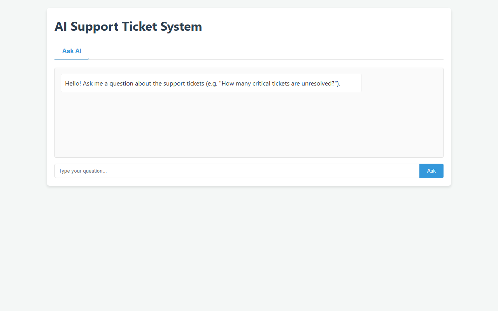

# AI Support Ticket System

Ask questions about support tickets in plain English and get answers computed from the data, not guessed.

This is an individual project I built to explore natural-language analytics over support tickets, and a safe pattern for LLM-backed analytics: the model never writes SQL. It emits a small JSON query plan, the plan is checked against an allow-list, and only then is it compiled into parameterized SQL. A deterministic rule engine flags anomalies alongside the chat, and a seeded generator plus a pandas-based evaluation measure how well it all works.

## Data

The dataset is synthetic. `generate_tickets.py` produces 2000 tickets (12 months of history, 12 agents, three categories, four priorities) from a fixed seed, so every figure in this README is reproducible:

    python generate_tickets.py --rows 2000 --seed 42 --as-of 2026-10-01

It also writes `data_truth/anomalies.csv`, the labelled anomaly list used to score the anomaly service. All data in this repository is synthetic, generated by `generate_tickets.py`; no real customer or company data is used.

## Quick Start

No API key is required if you have Ollama installed locally.

### 1. Install Ollama
- macOS / Linux: https://ollama.com/download
- Windows: https://ollama.com/download/windows

### 2. Pull the local model (one-time, ~2GB)
    ollama pull llama3.2:3b

### 3. Install Python dependencies
    pip install -r requirements.txt

### 4. Run
    uvicorn backend.app:app

Open http://127.0.0.1:8000 in your browser.

The database initializes automatically from `support_tickets.csv` on startup.

### Optional: Cloud LLM

To use Ollama's cloud model or Groq instead of local inference, create a `.env` file:

    OLLAMA_API_KEY=your_key_here
    # or
    GROQ_API_KEY=your_key_here

## Reproduce

    pip install -r requirements.txt
    python generate_tickets.py --rows 2000 --seed 42 --as-of 2026-10-01   # generate data
    pytest                                                                # run tests (76)
    python evaluate.py                                                    # anomaly precision/recall
    python eval/run_eval.py                                               # question-answering eval (needs Ollama or OLLAMA_API_KEY)

## Architecture

```
UI (HTML/JS) -> FastAPI -> LLM -> JSON query plan -> validator (allow-list) -> SQL compiler -> SQLite -> formatted response
```

1. **Frontend:** Vanilla HTML/JS served by FastAPI.
2. **Backend:** FastAPI + Uvicorn.
3. **LLM layer:** Emits a JSON query plan, never raw SQL.
4. **Compiler:** Converts the plan into parameterized SQL.
5. **Anomaly service:** Three deterministic rules, exposed via `/anomalies`.

## Endpoints

- `GET  /health`
- `POST /query` - body: `{"question": "..."}`
- `GET  /anomalies` - optional `?type=stale_high_priority|slow_resolution|low_rating`
- `GET  /tickets` - optional `?limit=&offset=`

## Example Queries & Outputs

All verified against raw SQLite (Total: 2000 records). The data is synthetic and generated by `generate_tickets.py`.

| Query | Answer |
|---|---|
| How many tickets are unresolved? | 47 tickets match this query. |
| How many tickets are open? | 30 tickets match this query. |
| How many critical tickets are unresolved? | 19 tickets match this query. |
| Which agent resolved the most tickets? | AGT-05 (Agent) has the most, with 185 tickets. |
| Which agent has the lowest average rating? | AGT-08 (Agent) has the lowest average, at 3.14. |
| What is the average customer rating? | The average customer rating is 4.11. |
| How many tickets per priority? | Table: Critical 233, High 520, Low 564, Medium 683 |

Anomaly counts: 115 total (19 stale_high_priority, 56 slow_resolution, 40 low_rating).



## Models and Tools

- **Primary LLM (local):** `llama3.2:3b` via Ollama
- **Primary LLM (cloud):** `gpt-oss:120b-cloud` via Ollama Cloud API
- **Fallback LLM:** Groq `llama3-8b-8192`
- **Graceful degradation:** Regex parser covers the sample queries when no LLM is reachable
- **Backend:** FastAPI + Uvicorn
- **Database:** SQLite (initialized from CSV on startup)

## Evaluation

Full per-question detail is in [`eval/results.md`](eval/results.md). Reproduce with `python eval/run_eval.py` (uses Ollama Cloud if `OLLAMA_API_KEY` is set, otherwise local Ollama).

**Question answering** (30 in-scope questions, gold answers computed with pandas from `support_tickets.csv`, scored as exact match):

| Mode | Correct | Refused | Confidently wrong |
|---|---|---|---|
| Regex fallback | 12/30 (40.0%) | 18 | 0 |
| Ollama Cloud `gpt-oss:120b-cloud` | 30/30 (100.0%) | 0 | 0 |

By category (regex / Ollama Cloud): count 2/6 / 6/6, average 1/5 / 5/5, group-by 4/6 / 6/6, filter 0/4 / 4/4, date range 0/3 / 3/3, top agent 3/3 / 3/3, top category 2/3 / 3/3.

**Out-of-scope questions** (5: two comparisons, trend, median, percentile):

| Mode | Refused | Gave an answer |
|---|---|---|
| Regex fallback | 5/5 | 0 |
| Ollama Cloud `gpt-oss:120b-cloud` | 3/5 | 2 (both comparisons) |

For the two comparisons the cloud model returned a per-group average table (Billing vs Technical, Critical vs Low) instead of refusing. The numbers in it are real, but the system does not compare them or say which is faster, and it is not a supported query type, so it is counted as a wrong answer. Trend, median and percentile were refused.

**Caveats on these numbers**
- The LLM column is a single run against a nondeterministic model; another run can differ. An earlier run of the same questions scored 29/30: the model once wrote `order_by: "avg_*"`, SQLite silently ignored the unknown name, and an unsorted row was reported as "lowest". That exposed a validator gap, which is now fixed (and tested), and the 30/30 run is after the fix.
- The 30 questions were also used while fixing the regex parser and that validator gap, so they are a development set, not a held-out test. Treat the scores as a regression check, not an estimate of accuracy on unseen questions.
- The regex fallback only handles fixed phrasings (counts by status/priority, per-dimension counts, best/worst average rating, most tickets). When a question carries a filter or breakdown it does not understand (a category name, a date window, "high priority"), it refuses instead of answering a simpler question.

**Anomaly detection** (`evaluate.py`, truth in `data_truth/anomalies.csv` from `generate_tickets.py --as-of 2026-10-01 --seed 42`): precision 1.00 / recall 1.00 for each of `stale_high_priority` (19), `slow_resolution` (56) and `low_rating` (40). The truth file applies the same rules as `backend/database.py`, so this checks that the service implements its stated rules and does not validate the rules themselves.

**Tests** (`pytest`, 76 tests): the plan validator, parameterized SQL compilation, injection strings, formatter wording, the regex parser's refusals and the API response shapes are covered under `tests/`.

## Known Limitations

- **Regex fallback is narrow** - 12/30 correct and 18 refused in the eval; it refuses what it cannot map rather than guessing.
- **Comparison questions are not refused by the LLM path** - the cloud model answers them with a per-group table (see Evaluation) rather than a comparison.

- **Multi-column group-by** ("per agent per category") - the QueryPlan schema supports a single `group_by` field.
- **Median / percentile aggregations** - supported: count, mean, sum, min, max.
- **Comparison queries** ("this month vs last month") - not supported.
- **Trend queries** ("trend in ticket volume") - not supported.
- **Anomaly questions in chat** - deliberately routed to `/anomalies` and the Anomalies tab, not the chat endpoint, to keep anomaly rules deterministic and auditable.
- **Model size** - `llama3.2:3b` occasionally misparses nested filters; mitigated by intent validation and a one-shot retry.
- **No authentication** - not implemented; this is a single-user local tool.

## What I'd Improve With More Time

- Multi-column group-by support
- Median / percentile aggregations
- Chart rendering for group-by queries
- JWT auth and multi-tenant isolation
- Postgres backend for production scale

## Decision Log

- **Query plan over raw SQL:** generating SQL directly via LLMs is unsafe. A JSON plan is checked against an allow-list (`backend/validator.py`) before compilation.
- **Ollama primary:** zero-key setup, no rate limits, no ticket data leaving the machine.
- **Rule-based anomalies:** auditability. A support manager needs a human-readable reason, not a black-box score.
- **SQLite over Postgres:** 2000 rows; swap the connection string when scaling.